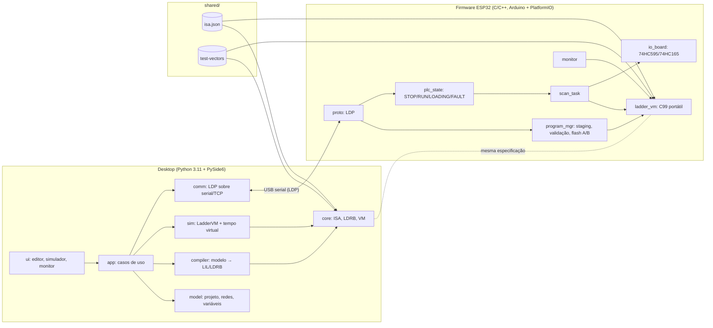
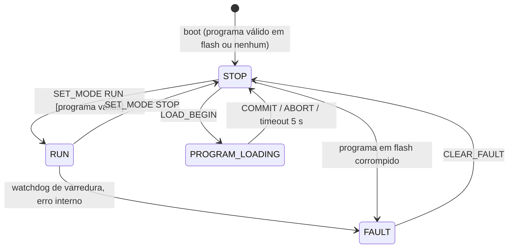

# Arquitetura

## 1. Visão geral



Princípios:

1. **Um contrato, duas implementações verificadas.** A semântica está em
   `docs/ladder-specification.md`; os números em `shared/specifications/isa.json`
   (gerando `ladder_isa.h`). As VMs Python e C são pequenas (≈ 250 linhas
   cada) e comparadas **varredura a varredura**, incluindo o fluxo de energia
   de cada instrução, por vetores escritos à mão e por *fuzzing* diferencial
   (ADR 0002).
2. **O modelo não depende da interface.** `core`, `model`, `compiler`, `sim`
   e `comm` não importam PySide6 e são testáveis sem tela.
3. **A VM não conhece tempo real nem hardware.** Recebe entradas e `dt`;
   devolve saídas. Temporização, E/S física e estados são do hospedeiro.

## 2. Desktop — pacotes (`desktop/src/ladderide/`)

| Pacote | Responsabilidade | Etapa |
|---|---|---|
| `core` | ISA, formato LDRB, montador LIL, VM de referência, CRC | 1–3 ✅ |
| `model` | Projeto: redes como árvore série/paralelo, variáveis com nome/endereço, configuração de E/S e alvo; serialização JSON versionada | 4 |
| `compiler` | Validação semântica (variáveis não declaradas, bobinas duplicadas…), geração de LDRB + mapa de depuração (instrução → elemento gráfico) | 4 |
| `sim` | Execução contínua/passo a passo/por varredura com tempo virtual ou real | 4 |
| `comm` | Transporte (serial/TCP), quadros LDP, transferência transacional, *polling* do monitor | 6–7 |
| `ui` | Editor gráfico (Qt Graphics View), painéis de simulação e monitor | 4, 7 |

Regra: nenhum arquivo em `ui` contém regra de execução LADDER — a interface
apenas desenha o modelo e o estado retornado pela VM/dispositivo.

### 2.1 Modelo de rede (editor → compilador)

Cada rede é uma árvore: `Serie[elementos]`, `Paralelo[Serie…]`, folhas de
contato (`XIC/XIO/NOT`) e, no final, uma ou mais saídas em paralelo
(`OTE/OTL/OTU/TON/TOF/RTO/CTU/CTD/RES`). A tradução para LIL é direta:
`Paralelo` → `BST … NXB … BND`. O editor só permite construir árvores válidas,
o que elimina, por construção, curtos-circuitos e ligações sem retorno.

## 3. Firmware — módulos (`firmware/`)

| Módulo | Responsabilidade |
|---|---|
| `lib/ladder_vm` | VM, validação LDRB, CRC — C99 puro, sem Arduino; compilado também no PC para testes ✅ |
| `src/io_board` | Mapeamento físico: 74HC595 (relés) e 74HC165 (entradas), polaridade, permutação de bits, sequência segura de inicialização |
| `src/plc_state` | Máquina de estados e política de saídas seguras |
| `src/scan_task` | Tarefa FreeRTOS periódica (10 ms), mede `dt` com `esp_timer`, chama a VM, watchdog de varredura |
| `src/program_mgr` | Staging em RAM, validação, gravação atômica em LittleFS, carga no boot |
| `src/proto` | Enquadramento LDP, despacho de comandos, sessão de carga com timeout |
| `src/monitor` | Instantâneo consistente do estado da VM para o protocolo |
| `src/diag` | Códigos de falha, contadores de erros, estatísticas de varredura |

### 3.1 Ciclo de varredura no dispositivo

```
a cada 10 ms (vTaskDelayUntil):
  t0 = esp_timer_get_time()
  1. entradas  = io_board_read()            (74HC165, com permutação/polaridade)
  2. dt        = (t0 - t_anterior) em ms, carregando o resto em µs
  3. se RUN:  saidas = lv_vm_scan(vm, entradas, dt)
     senão:   saidas = safe_outputs
  4. io_board_write(saidas)                 (74HC595 + latch)
  5. publica instantâneo para o monitor (seção crítica curta)
  6. mede duração; > 5 ms conta "overrun"; > 50 ms → FAULT(SCAN_TIMEOUT)
```

Comunicação roda em outra tarefa (prioridade menor). O instantâneo para o
monitor é copiado sob *mutex* após a varredura, nunca durante.

### 3.2 Estados



| Estado | VM | Saídas físicas | Observação |
|---|---|---|---|
| STOP | parada | `safe_outputs` | estado de boot padrão |
| RUN | varre a cada 10 ms | imagem `Q` | entrada em RUN = partida a frio |
| PROGRAM_LOADING | parada | `safe_outputs` | só a partir de STOP |
| FAULT | parada | `safe_outputs` | exige CLEAR_FAULT explícito |

Desconexão do Desktop **não** altera o estado: um CLP continua controlando o
processo sem supervisão. *Auto-RUN* no boot é opcional (configuração do
firmware, desligado por padrão — decisão pendente com o professor).

## 4. Lógico × físico no monitor

O ESP32 informa separadamente: `Q` lógico (resultado da VM) e `Q` comandado
(o que foi deslocado para o 74HC595, já com a política de estado seguro).
**A placa não tem realimentação dos contatos dos relés**; a interface exibirá
"estado físico: não observado" e nunca afirmará que o relé comutou.
