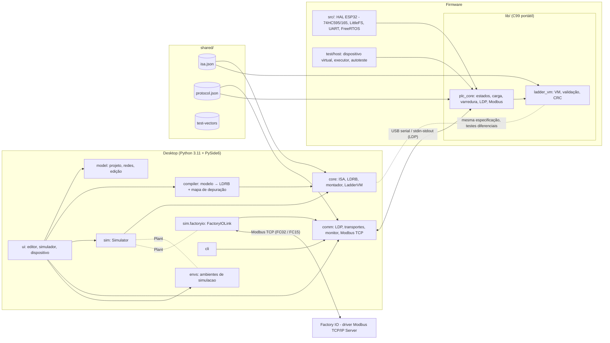
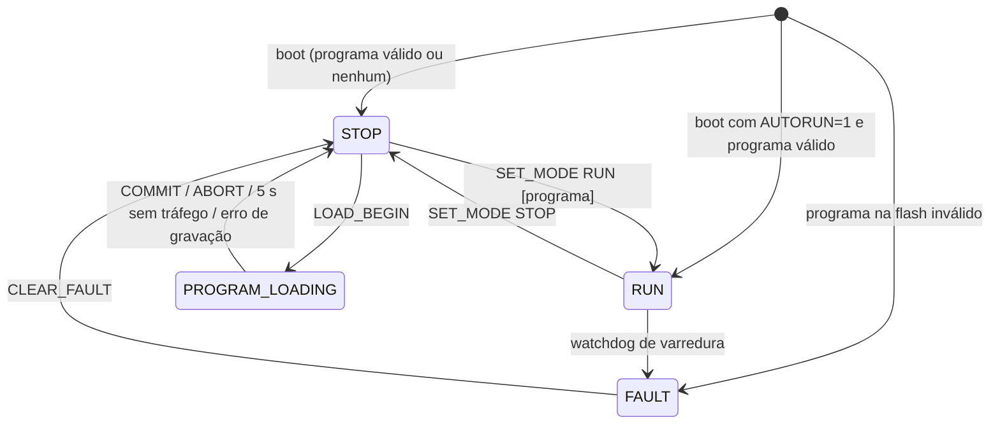

# Arquitetura

## 1. Visão geral



Princípios:

1. **Um contrato, duas VMs verificadas** (ADR 0002): semântica em
   `docs/ladder-specification.md`; números em `isa.json`/`protocol.json`
   (headers C gerados e conferidos nos testes).
2. **Modelo independente da interface:** `core`, `model`, `compiler`, `sim`,
   `comm` não importam PySide6. Nenhuma regra LADDER fica em `ui/`.
3. **A VM não conhece tempo real nem hardware:** recebe entradas e `dt` (ADR 0005).
4. **Lógica do dispositivo portátil** com HAL; o mesmo código roda no ESP32 e
   no dispositivo virtual (ADR 0006).

## 2. Desktop — pacotes (`desktop/src/ladderide/`)

| Pacote | Responsabilidade |
|---|---|
| `core` | ISA, formato LDRB, montador LIL, VM de referência, CRC |
| `model` | Projeto `.ladproj` versionado; redes em árvore série/paralelo; operações de edição que preservam a validade |
| `compiler` | Validação (símbolos, operandos, faixas, acionamento único, estrutura), geração LDRB, mapa instrução↔elemento, importador LIL/LDRB |
| `sim` | Simulador com tempo virtual: contínuo, por varredura, passo a passo; protocolo `Plant` para processos externos; ponte com o Factory IO (`factoryio.py`) |
| `envs` | Ambientes de simulação (plugins com `@register`), adaptador `EnvironmentPlant`, física e desenho comuns |
| `comm` | Quadros LDP, transportes (serial, TCP, processo), cliente com retransmissão, transferência transacional, monitor, equivalência no dispositivo, dispositivo virtual, cliente Modbus TCP (`modbus_tcp.py`) |
| `codegen`, `verify` | Tradução do diagrama para C++; verificação do programa no código C do firmware |
| `ui` | Janela, diagrama (Qt Graphics View), paleta, painéis de simulação, dispositivo, ambiente e Factory IO |
| `cli` | Linha de comando para hardware e evidências |

### 2.1 Modelo de rede

Cada rede: `condição` (lista série de contatos, NOT e `Parallel`, cujos ramos
são listas série) e `saídas` (bobinas, TON/TOF/RTO, CTU/CTD, RES em paralelo).
O editor só constrói árvores válidas. A tradução é direta: `Parallel` →
`BST … NXB … BND`; várias saídas → `BST out NXB out BND`.

### 2.2 Visualização ao vivo

A view recebe uma "fonte ao vivo" com a mesma interface no simulador
(`Simulator`) e no monitor (`MonitorSource`, a partir do instantâneo do
dispositivo). A energia de cada fio vem do bit `power[pc]` da instrução que o
alimenta, mapeado pelo compilador (`element_pc`, `branch_end_pc`).

### 2.3 Processos externos (`Plant`)

O simulador conhece uma única interface de processo físico, o protocolo `Plant`. Os
ambientes internos (`EnvironmentPlant`) e o Factory IO (`FactoryIOLink`, ADR 0007) são
adaptadores dessa interface, e a janela escolhe qual está ligado: o Factory IO, se
conectado, ou o ambiente escolhido. Os padrões de projeto usados estão em
`docs/design-patterns.md`.

## 3. Firmware

| Módulo | Responsabilidade |
|---|---|
| `lib/ladder_vm` | VM, validação LDRB, CRC |
| `lib/plc_core/plc_runtime` | Estados, carga transacional (staging → validação → gravação atômica → ativação), varredura, `dt` com resto em µs, watchdog, comandos LDP, instantâneo |
| `lib/plc_core/ldp_frame` | Enquadramento com ressincronização e timeout |
| `lib/plc_core/modbus_rtu` | Escravo Modbus RTU somente leitura |
| `src/io_board` | 74HC595/74HC165, mapeamento e polaridade, inicialização segura |
| `src/storage` | LittleFS com gravação atômica (`/prog.new` → `/prog.bin`) |
| `src/main.cpp` | HAL, tarefa de varredura (FreeRTOS, `vTaskDelayUntil` 10 ms, núcleo 1), laço de comunicação, mutex único |
| `src/board_config.h` | Pinos, polaridade, mapeamentos, AUTORUN, Modbus — único arquivo a mudar para outra placa |

### 3.1 Ciclo de varredura no dispositivo (`plc_scan`)

```
1. entradas := HAL.read_inputs()  (74HC165; o 595 reenvia as saídas atuais)
2. estatística de intervalo; atraso se intervalo > 2 × período
3. em RUN: dt := (agora − anterior + resto_µs) / 1000 (0 na 1ª varredura)
           Q := lv_vm_scan(entradas, dt);  comandado := Q
   senão:  comandado := safe_outputs
4. HAL.write_outputs(comandado)  (74HC595 + latch)
5. duração > 50 ms em RUN → FAULT(SCAN_TIMEOUT), saídas seguras
```

O monitor lê um instantâneo sob o mesmo mutex, portanto sempre consistente
(nunca no meio de uma varredura).

### 3.2 Estados



| Estado | VM | Saídas físicas |
|---|---|---|
| STOP | parada (ou modo teste) | `safe_outputs` |
| RUN | varre a cada 10 ms; entrada = partida a frio | imagem Q |
| PROGRAM_LOADING | parada | `safe_outputs` |
| FAULT | parada | `safe_outputs` |

Perda de comunicação **não** altera o estado: o CLP continua controlando o
processo sem supervisão.

## 4. Lógico × físico

O dispositivo informa Q lógico (resultado da VM) e Q comandado (enviado ao
74HC595, após a política de estado seguro). A placa não tem realimentação dos
contatos; a IDE nunca afirma que um relé comutou.
