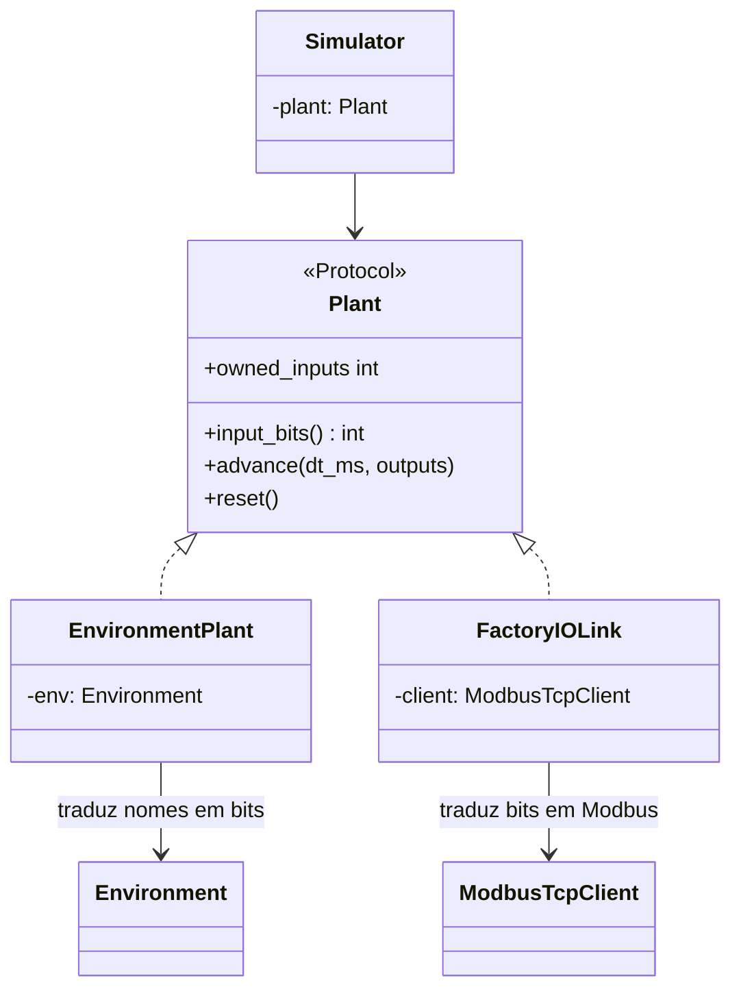
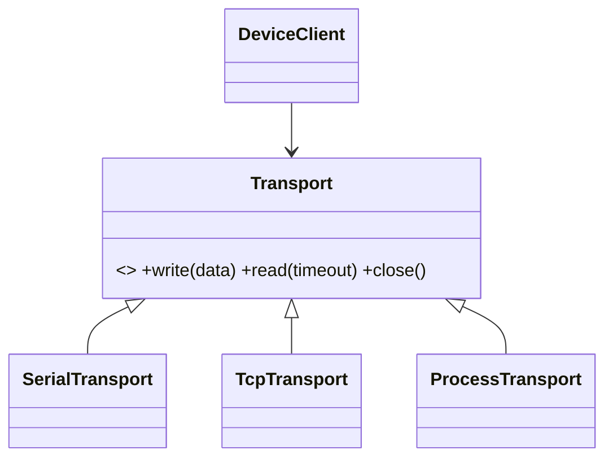
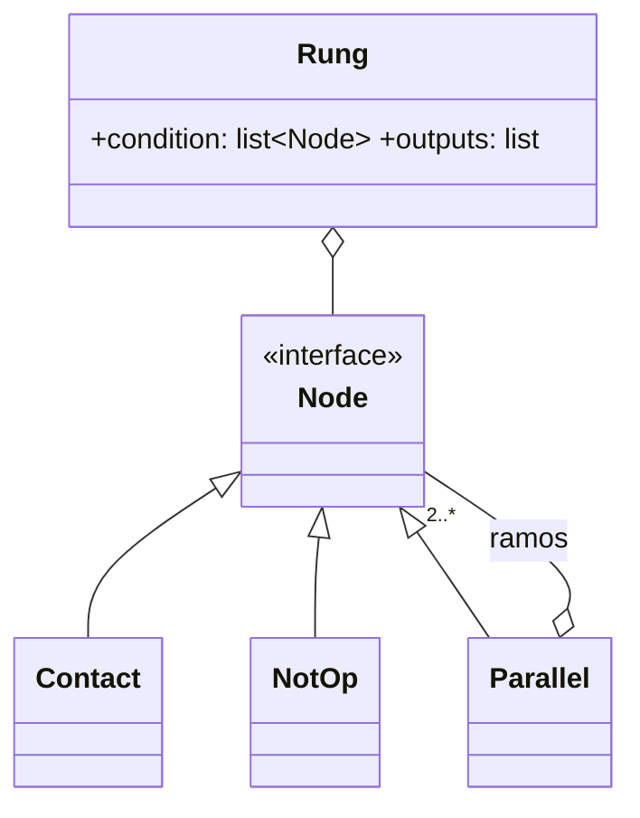

# Padrões de projeto

Este documento lista os padrões de projeto usados no código, com o problema que cada um
resolve e onde ele está. Os padrões do catálogo GoF (GAMMA et al., 1995) aparecem com o
nome original em inglês. Os demais vêm marcados com a origem: arquitetura em camadas,
*Registry* e *Plugin* (FOWLER, 2002); *Hardware Abstraction Layer* (sistemas embarcados).

| Padrão | Categoria | Onde | Problema resolvido |
|---|---|---|---|
| [Adapter](#1-adapter) | Estrutural (GoF) | `EnvironmentPlant`, `FactoryIOLink`, `MonitorSource` | Ligar fontes diferentes ao simulador e ao diagrama sem mudá-los |
| [Strategy](#2-strategy) | Comportamental (GoF) | `Transport` e subclasses | Trocar o meio físico (USB, TCP, processo) sem mudar o protocolo |
| [Template Method](#3-template-method) | Comportamental (GoF) | `Environment` | Ambientes novos só implementam a física e o desenho |
| [Composite](#4-composite) | Estrutural (GoF) | `Rung`, `Parallel` | Ramos paralelos dentro de ramos paralelos, tratados de forma uniforme |
| [Interpreter](#5-interpreter) | Comportamental (GoF) | `LadderVM` (Python) e `ladder_vm` (C) | Executar o programa LADDER compilado |
| [Observer](#6-observer) | Comportamental (GoF) | sinais Qt (`SpeedModel`, `DeviceSession`, `FactoryIOPanel`) | Vários componentes de tela reagindo ao mesmo estado |
| [Memento](#7-memento) | Comportamental (GoF) | desfazer/refazer (`MainWindow.push_undo`) | Voltar a um estado anterior do projeto |
| [Command](#8-command) | Comportamental (GoF) | `QAction` criadas em `MainWindow._act` | O mesmo comando no menu, na barra e no atalho |
| [Facade](#9-facade) | Estrutural (GoF) | `compile_project`, `DeviceClient` | Esconder etapas internas atrás de uma chamada simples |
| [Factory Method](#10-factory-method) | Criacional (GoF) | `envs.registry.create`, `node_from_dict` | Criar objetos a partir de um identificador salvo |
| [Registry e Plugin](#11-registry-e-plugin) | Arquitetural (Fowler) | `@register`, `discover()` | Ambientes novos sem alterar a IDE |
| [Máquina de estados](#12-máquina-de-estados) | Comportamental | `SimState`, estados do firmware | Comandos permitidos dependem do estado |
| [Camadas e HAL](#13-camadas-e-hal) | Arquitetural | pacotes do Desktop, `plc_hal_t` | Regras independentes de interface e de hardware |

Os caminhos abaixo são relativos a `desktop/src/ladderide/` (Desktop) e a `firmware/` (firmware).

---

## 1. Adapter

**Problema.** O simulador conhece uma única interface de processo físico, o protocolo
`Plant` (`sim/simulator.py`): `owned_inputs`, `input_bits()`, `advance()` e `reset()`.
Os processos reais têm interfaces diferentes: um ambiente fala em nomes de pontos
(`"START"`, `"BELT"`) e o Factory IO fala em endereços Modbus.

**Solução.** Cada fonte ganha um adaptador que implementa `Plant`:

| Adaptador | Adapta | Para |
|---|---|---|
| `EnvironmentPlant` (`envs/base.py`) | `Environment` (pontos por nome, contatos NA/NF) | `Plant` (bits I/Q) |
| `FactoryIOLink` (`sim/factoryio.py`) | Factory IO (FC02/FC15 por Modbus TCP) | `Plant` |
| `MonitorSource` (`comm/monitor.py`) | instantâneo lido do ESP32 (`Snapshot`) | `LiveSource` (`ui/ladder_view.py`), a mesma interface do `Simulator` |

Com isso, o diagrama é animado pelo simulador ou pelo CLP real sem distinguir um do outro,
e o Factory IO entrou no projeto sem nenhuma mudança no `Simulator`.

## 2. Strategy

**Problema.** O protocolo LDP é o mesmo pela USB, por TCP ou falando com o dispositivo
virtual (processo local), mas cada meio lê e escreve bytes de um jeito.

**Solução.** A classe abstrata `Transport` (`comm/transport.py`) define `write()`,
`read()` e `close()`. `SerialTransport`, `TcpTransport` e `ProcessTransport` são as
estratégias. O `DeviceClient` (`comm/client.py`) recebe uma delas no construtor e não
sabe qual é.

## 3. Template Method

**Problema.** Todos os ambientes de simulação compartilham o comportamento do operador
(botão pulsador, chave com trava, contatos NF) e o cálculo dos cliques. Muda apenas a
física e o desenho de cada processo.

**Solução.** A classe abstrata `Environment` (`envs/base.py`) implementa as partes fixas
(`press()`, `control_at()`, `is_pressed()`) e deixa abstratos os passos variáveis:
`reset()`, `step()`, `sensors()` e `paint()`. Os ganchos opcionais `alarms()`, `stats()`,
`controls()` e `on_control()` têm implementação padrão vazia. Cada ambiente em
`envs/builtin/` só preenche esses passos.

## 4. Composite

**Problema.** Uma rede LADDER tem contatos em série e ramos em paralelo, e um ramo pode
conter outro paralelo, em qualquer profundidade.

**Solução.** A condição de uma `Rung` é uma lista em série de nós. O nó `Parallel`
(`model/project.py`) contém ramos que também são listas de nós, inclusive outros
`Parallel`. O compilador, o editor e o percurso `Project.walk()` tratam folhas
(`Contact`, `NotOp`) e compostos (`Parallel`) pela mesma recursão.

## 5. Interpreter

**Problema.** Executar o programa do usuário de forma idêntica no PC e no ESP32.

**Solução.** O compilador traduz o diagrama para um *bytecode* (LDRB). Duas máquinas
virtuais o interpretam com a mesma especificação: `LadderVM` (`core/vm.py`) no
simulador e `lib/ladder_vm` (C) no firmware. Cada instrução (`XIC`, `BST`, `TON`...)
atua sobre o RLO e a pilha de ramos.

Aqui o padrão aparece na forma de máquina virtual de *bytecode*, e não como a árvore de
classes do GoF: a gramática é compilada antes, o que dá tempo de execução limitado e
o mesmo código no microcontrolador. O ADR 0002 registra essa decisão.

## 6. Observer

**Problema.** A velocidade da simulação é exibida e alterada em três lugares: a caixa na
barra de ferramentas, a caixa no painel Simulador e a barra deslizante.

**Solução.** O `SpeedModel` (`ui/speed_control.py`) é o sujeito, com o sinal
`changed`. `SpeedCombo` e `SpeedSlider` são observadores e se atualizam sozinhos. O
mesmo mecanismo de sinais do Qt liga:
- a sessão do dispositivo à janela (`DeviceSession`: `snapshot`, `disconnected`, `progress`);
- o painel Factory IO à janela (`FactoryIOPanel.linkChanged`).

## 7. Memento

**Problema.** Desfazer e refazer edições do diagrama sem expor a estrutura interna do
projeto.

**Solução.** Antes de cada edição, `MainWindow.push_undo()` guarda um instantâneo
`Project.to_dict()` na pilha `undo_stack`. `undo()` e `redo()` restauram o instantâneo
com `Project.from_dict()`. A janela guarda os mementos, mas não os interpreta.

## 8. Command

**Problema.** O mesmo comando ("Compilar", "Executar", "Transferir") fica no menu, na
barra de ferramentas e num atalho, e precisa ser habilitado ou desabilitado em um só lugar.

**Solução.** Cada comando é uma `QAction` criada em `MainWindow._act()` com texto,
atalho, dica e o método executor. Menus e barras recebem a mesma ação, e
`_update_actions()` controla o estado de todas.

## 9. Facade

**Problema.** Compilar envolve validar símbolos e operandos, montar o bytecode, gerar a
imagem LDRB e o mapa de depuração. Transferir envolve quadros, CRC, retransmissão e a
sequência LOAD_BEGIN…COMMIT.

**Solução.** `compile_project(project)` (`compiler/compiler.py`) devolve um
`CompileResult` e esconde a classe interna `_Compiler`. `DeviceClient.download(image)`
(`comm/client.py`) executa a transferência transacional inteira. A interface e a CLI
usam só essas duas chamadas.

## 10. Factory Method

**Problema.** O projeto salvo guarda apenas identificadores (`"environment": "silo"`,
`{"type": "timer", ...}`), e é preciso recriar os objetos certos ao abrir o arquivo.

**Solução.** `envs.registry.create(env_id)` cria o ambiente a partir do identificador.
`node_from_dict(d)` (`model/project.py`) cria o nó certo (`Contact`, `TimerBox`,
`Parallel`...) a partir do campo `type`.

## 11. Registry e Plugin

**Problema.** Acrescentar ambientes de simulação sem editar a IDE, inclusive ambientes
do próprio usuário.

**Solução.** O decorador `@register` (`envs/registry.py`) inscreve cada classe num
registro. `discover()` importa todos os módulos de `envs/builtin/` e os arquivos `.py`
de `~/.ladderide/ambientes/`. Um plugin com erro é listado em `load_errors` e não
derruba a IDE. O guia está em `docs/simulation-environments.md`.

## 12. Máquina de estados

**Problema.** O que é permitido depende do estado. Por exemplo, a carga de programa só
vale em STOP, e RUN exige um programa válido.

**Solução.** Os estados são explícitos e as transições ficam centralizadas:
- **Simulador:** `SimState` (PARADO, EXECUTANDO, PAUSADO), com transições em `Simulator.start/pause/stop/reset`.
- **Firmware:** STOP, RUN, PROGRAM_LOADING e FAULT (`lib/plc_core/plc_runtime.c`), com o diagrama em `docs/architecture.md` §3.2.

Os estados são enumerações com transições num só módulo, e não uma classe por estado
como no padrão State do GoF. Com poucos estados e regras simples, essa forma é mais clara
e também cabe no C do firmware.

## 13. Camadas e HAL

**Problema.** Testar as regras do CLP sem a interface gráfica e sem a placa.

**Solução.**
- **Desktop em camadas:** `core`, `model`, `compiler`, `sim` e `comm` não importam
  PySide6; `ui` depende deles, nunca o contrário (`docs/architecture.md`, princípio 2).
  Por isso a CLI e os testes usam o mesmo código da IDE.
- **Firmware com HAL:** `plc_hal_t` (`lib/plc_core/plc_runtime.h`) é uma tabela de
  funções (`read_inputs`, `write_outputs`, `storage_load/save`, `send`, `micros`). O
  ESP32 (`src/main.cpp`) e o dispositivo virtual (`test/host/virtual_device.c`)
  fornecem implementações diferentes para o mesmo `plc_core` (ADR 0006). É o padrão
  Strategy em C, por ponteiros de função.

## Referências

FOWLER, M. **Patterns of enterprise application architecture**. Boston: Addison-Wesley, 2002.

GAMMA, E.; HELM, R.; JOHNSON, R.; VLISSIDES, J. **Design patterns**: elements of reusable
object-oriented software. Reading: Addison-Wesley, 1995.
