# LadderIDE — Funcionalidades implementadas

21/10/2026 · versão 0.9.0

## Introdução

A LadderIDE é um ambiente completo para programar um CLP em linguagem LADDER: edita o diagrama, compila, simula, transfere o programa para uma placa ESP32 de 8 relés e controla cenas 3D do Factory IO. Este relatório mostra cada funcionalidade implementada com um print da versão 0.9.0 e explica como ela funciona.

Os prints foram tirados da própria IDE, com os exemplos do repositório: `esteira_lote` (Factory IO), `semaforo` (ambiente interno) e `temporizadores`.

| Funcionalidade | Onde fica na IDE |
| --- | --- |
| Editor LADDER | Área central + painel Instruções |
| Símbolos | Painel Símbolos (abaixo) |
| Escolha do controlador | Arquivo → Novo |
| Simulador | Painel Simulador (direita), F5 |
| Ambientes de simulação | Painel Ambiente, Ctrl+E |
| Factory IO (Modbus TCP) | Simulação → Factory IO |
| Blocos de instrução | F12 |
| Código C++ | Ctrl+F7 |
| Placa ESP32 virtual | Ctrl+Shift+E |
| Transferência e monitor | Painel Dispositivo, F8 |
| Verificar para ESP32 | F9 |

## 1. Editor de diagrama LADDER

O programa é montado arrastando instruções da paleta para as redes, sem digitar código. Cada rede tem uma condição (contatos em série e em paralelo) e uma ou mais saídas à direita.

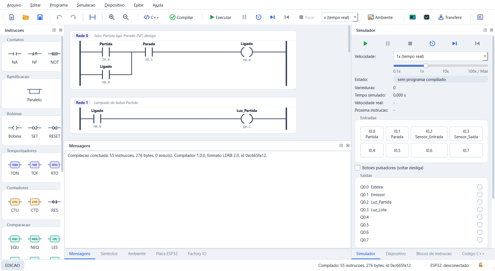

**Como funciona:**

- **Paleta (esquerda):** contatos NA/NF/NOT, ramo paralelo, bobina, SET e RESET, temporizadores TON/TOF/RTO, contadores CTU/CTD/RES, comparação (EQU, NEQ, LES, GRT, LEQ, GEQ, LIM, MEQ) e matemática (ADD, SUB, MUL, DIV, SQR, NEG, TOD, FRD).
- **Redes:** cada uma tem número e comentário. Acima do elemento aparece o símbolo (ex.: `Partida`) e abaixo o endereço (ex.: `I0.0`).
- **Edição:** desfazer/refazer (Ctrl+Z / Ctrl+Y, até 100 passos), excluir, zoom e nova rede (Ctrl+R).
- **Compilar (F7):** o painel Mensagens mostra o resultado. No exemplo: 55 instruções, 276 bytes, 0 avisos. Um erro aponta a rede e o elemento, que ficam destacados em vermelho no diagrama. Programa com erro nunca é gerado.

Um duplo clique no elemento abre o diálogo de edição, com o tipo da instrução e o operando:

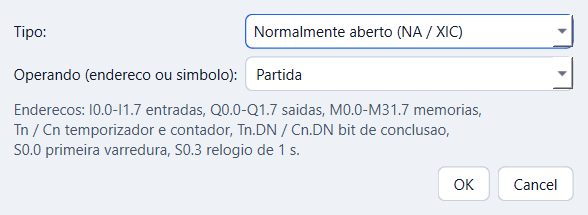

O operando aceita endereço (`I0.0`) ou símbolo (`Partida`). A lista sugere os símbolos do projeto, e o texto abaixo resume as faixas de endereços válidas do controlador.

## 2. Símbolos, endereços e controlador

Símbolos dão nomes aos endereços, para o diagrama ser lido como o processo (`Sensor_Saida` em vez de `I0.3`). O controlador escolhido no projeto define quantos endereços existem.

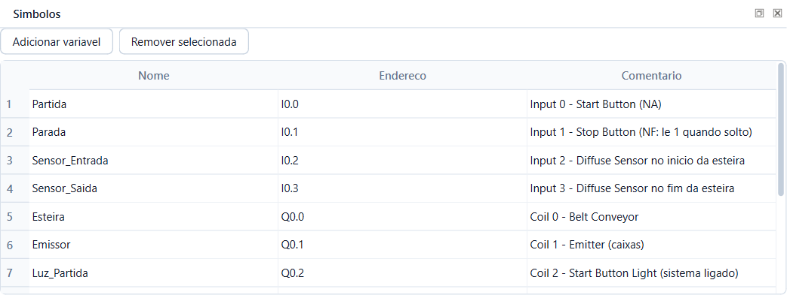

**Como funciona a tabela de símbolos:**

- Cada linha tem nome, endereço e comentário, editáveis com duplo clique.
- **Adicionar variável** cria `VarN` em `M0.0`; **Remover selecionada** apaga a linha.
- O compilador recusa nomes inválidos, repetidos ou com cara de endereço (ex.: `Q0.1`).
- Renomear um símbolo troca o nome em todo o diagrama, inclusive em `Caixas.DN`.

**Endereços disponíveis:**

| Endereço | Significado |
| --- | --- |
| `I0.0`–`I1.7` | Entradas |
| `Q0.0`–`Q1.7` | Saídas (relés) |
| `M0.0`–`M31.7` | Memórias internas |
| `Tn`, `Cn` | Temporizador e contador (`.DN` = concluído) |
| `Nn` | Registradores inteiros de 32 bits |
| `S0.0`, `S0.3` | Primeira varredura, relógio de 1 s |

**Escolha do controlador:** ao criar um projeto (Arquivo → Novo), escolhe-se o CLP de destino. Ele limita entradas, saídas, memórias, temporizadores, contadores e registradores.

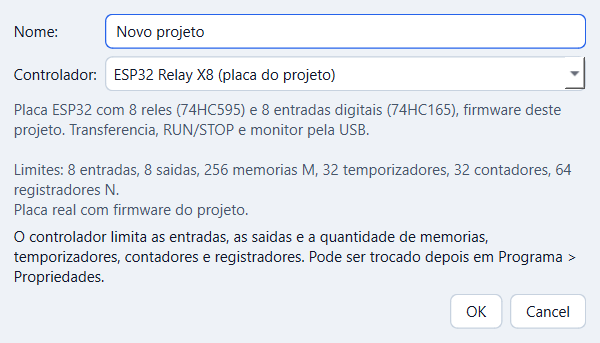

A ESP32 Relay X8 tem 8 entradas e 8 saídas. A opção *Somente simulação* tem 16 E/S e serve para cenas maiores do Factory IO. O controlador pode ser trocado depois em Programa → Propriedades.

## 3. Simulador

O simulador executa o programa no PC, sem placa, e anima o diagrama com o fluxo de energia. Ele roda o mesmo bytecode que o firmware do ESP32, por isso o comportamento simulado é o mesmo da placa.

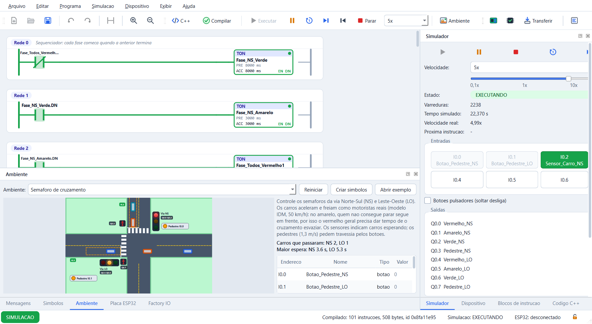

**Como funciona:**

- **Comandos:** Executar (F5), Pausar (F6), uma Varredura (F10), um Passo de instrução (F11), Reiniciar a frio (Ctrl+F5) e Parar (Shift+F5). Durante a simulação o diagrama não pode ser editado.
- **Fluxo de energia:** trilhos e contatos que conduzem ficam verdes. Temporizadores e contadores mostram PRE, ACC e os bits EN/DN.
- **Velocidade:** de 0,01× a 1000× ou a máxima do PC, pela caixa, pela barra deslizante ou por Ctrl+. e Ctrl+,. O painel mostra a velocidade real alcançada (5,02× no print).
- **Estado:** número de varreduras, tempo simulado e próxima instrução (no modo passo a passo).
- **Entradas:** botões que ligam e desligam `I0.x` com o nome do símbolo. Com *Botões pulsadores*, a entrada desliga ao soltar. Entradas comandadas por um ambiente ou pelo Factory IO ficam travadas (em cinza).
- **Saídas:** lâmpadas de `Q0.0` a `Q0.7`, acesas em verde quando ligadas.

A varredura simulada é de 10 ms, igual à do firmware.

## 4. Ambientes de simulação

Um ambiente é um processo animado que o programa controla: as saídas `Q` acionam a cena e os sensores da cena voltam como entradas `I`. Serve para testar a lógica num processo realista sem montar hardware.

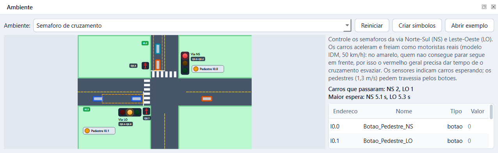

**Como funciona:**

- **Ambiente (Ctrl+E):** escolhe-se o processo na lista. Há sete: silo de envase, semáforo, portão de garagem, elevador, linha de garrafas, ar comprimido e misturador de batelada.
- **Cena:** desenhada a cada varredura. No semáforo, os carros aceleram e freiam como motoristas reais e os pedestres pedem travessia pelos botões.
- **Tabela de pontos:** lista endereço, nome, tipo e valor de cada entrada e saída usada pela cena.
- **Criar símbolos** copia os nomes da cena para a tabela de símbolos do projeto. **Abrir exemplo** carrega um programa pronto para aquele processo.
- **Alarmes:** o ambiente detecta erros de lógica (por exemplo, verde nas duas vias ao mesmo tempo) e mostra o alarme na cena.
- **Medições:** o painel mostra indicadores do processo, como carros que passaram e a maior espera em cada via.

Cada ambiente é um plugin independente: um novo processo entra sem alterar o simulador.

## 5. Integração com o Factory IO (Modbus TCP)

A simulação da IDE controla uma cena 3D do Factory IO pela rede. O Factory IO usa o driver *Modbus TCP/IP Server* e a IDE é o cliente: lê os sensores da cena e escreve os atuadores. A ligação foi testada com o Factory IO 2.2.3 real.

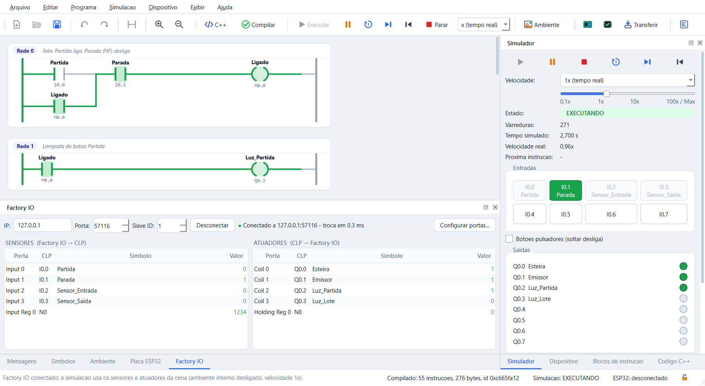

**Como funciona:**

1. No Factory IO: File → Drivers → *Modbus TCP/IP Server*, com Write Digital = Inputs e Read Digital = Coils. A cena vai para RUN.
2. Na IDE: Simulação → Factory IO. Preenche-se o IP mostrado no topo do driver (ex.: `192.168.56.1`), a porta 502 e o Slave ID, e clica-se em **Conectar**.
3. A cada 20 ms a IDE lê os sensores (FC02) e os Input Regs (FC04) e escreve as coils (FC15) e os Holding Regs (FC16). A varredura do programa nunca espera pela rede.
4. Executa-se a simulação (F5). As entradas que vêm da cena ficam travadas no painel do simulador.

O painel imita a janela do driver: **Sensores** (Factory IO → CLP) à esquerda e **Atuadores** (CLP → Factory IO) à direita. Cada porta mostra o endereço no CLP, o símbolo e o valor ao vivo.

| Porta do driver | Endereço no CLP | Função Modbus |
| --- | --- | --- |
| Input k | `I0.k` | FC02 (leitura) |
| Input Reg k | `N(inicial + k)`, padrão `N0` | FC04 (leitura) |
| Coil k | `Q0.k` | FC15 (escrita) |
| Holding Reg k | `N(inicial + k)`, padrão `N8` | FC16 (escrita) |

As quantidades e os endereços iniciais ficam em **Configurar portas...** e devem ser iguais aos do driver:

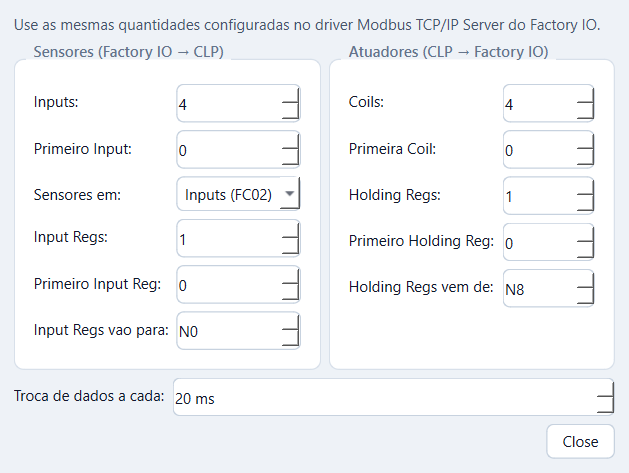

**Símbolos editáveis no painel:** a coluna Simbolo aceita duplo clique (ou F2). O nome digitado cria o símbolo do endereço, com a porta do Factory IO no comentário, ou renomeia o símbolo existente em todo o diagrama. Apagar o nome remove o símbolo. Nomes inválidos ou repetidos são recusados, e a alteração pode ser desfeita com Ctrl+Z.

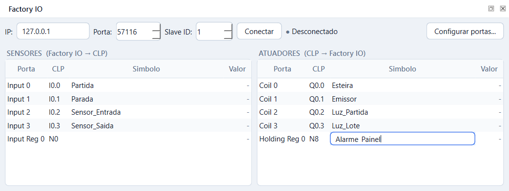

**Segurança:**

- Enquanto conectado, a velocidade fica travada em 1×, porque o Factory IO roda em tempo real.
- Se a conexão cair, os sensores vistos pelo programa vão a 0 e a IDE tenta reconectar a cada 1 s.
- Ao desconectar ou fechar a IDE, todas as coils e Holding Regs recebem 0, desligando os atuadores da cena.
- Os símbolos só podem ser editados com a simulação parada.

## 6. Endereços direto no diagrama LADDER

O endereço de um contato, bobina, temporizador ou contador pode ser trocado no próprio diagrama, sem abrir o diálogo completo.

**Como funciona:**

- Dá-se duplo clique no endereço escrito embaixo do elemento (ex.: `I0.0`), ou clique direito → **Alterar endereço...**.
- Abre uma caixa com os símbolos e endereços do projeto. Cada item mostra também a porta do Factory IO ligada a ele, por exemplo `I0.3 · Sensor_Saida · Input 3 (Factory IO)`.
- Escolhe-se um item ou digita-se o endereço. Enter confirma e Esc cancela.
- O duplo clique no resto do elemento continua abrindo o diálogo completo da seção 1.

A troca entra no desfazer (Ctrl+Z), como qualquer outra edição.

## 7. Do diagrama à placa ESP32

Estas ferramentas mostram o que o diagrama vira e levam o programa até o CLP real.

### 7.1 Blocos de instrução (F12)

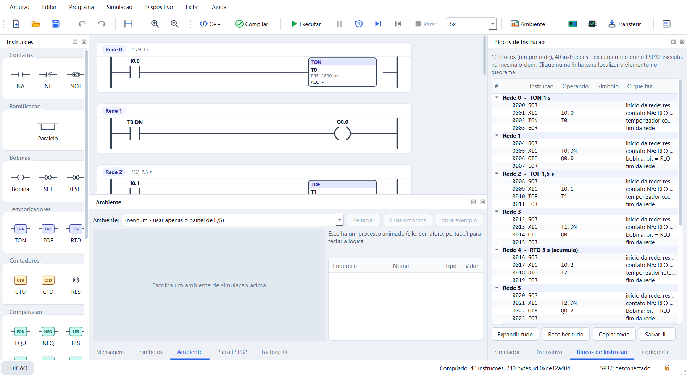

O diagrama é convertido em lista de instruções, um bloco por rede, exatamente na ordem que o ESP32 executa. Cada linha traz endereço, instrução (SOR, XIC, TON, OTE, EOR...), operando, símbolo e uma explicação. Clicar numa linha seleciona o elemento no diagrama, e durante a simulação a instrução atual fica destacada.

### 7.2 Código C++ (Ctrl+F7)

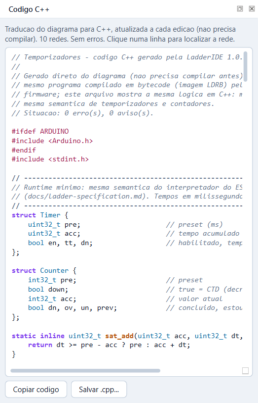

O diagrama é traduzido para C++ legível a cada edição, sem precisar compilar. Temporizadores e contadores viram estruturas com a mesma semântica do interpretador. Um teste automatizado compila esse C++ e confere que ele reproduz o simulador.

### 7.3 Simulador da placa ESP32 (Ctrl+Shift+E)

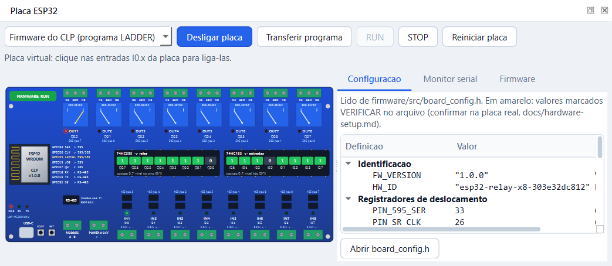

A placa de 8 relés é desenhada com o firmware real rodando no PC. O print mostra o firmware em RUN, os níveis dos registradores 74HC595 (relés) e 74HC165 (entradas) e o relé OUT1 ligado. A aba Configuração lê os pinos de `board_config.h` e a aba Monitor serial mostra os quadros do protocolo LDP.

### 7.4 Transferência e monitor online (F8)

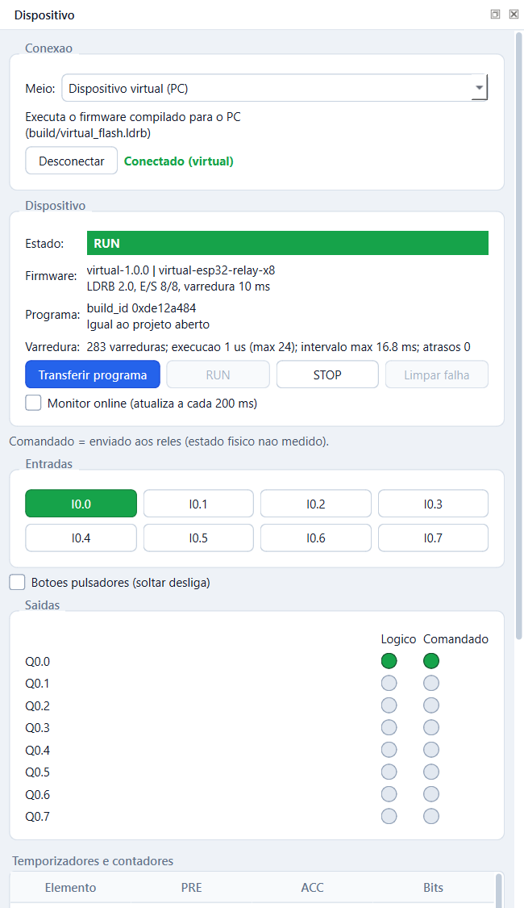

O painel Dispositivo conecta pela USB (ou ao dispositivo virtual) e mostra estado, versão do firmware, programa carregado e tempo de varredura. **Transferir programa** envia a imagem em blocos com CRC-32; o firmware valida antes de ativar e, se algo falhar, mantém o programa anterior. RUN e STOP comandam a placa, e o **Monitor online** anima o diagrama com o estado real, mostrando para cada saída o valor lógico e o comandado.

### 7.5 Verificar para ESP32 (F9)

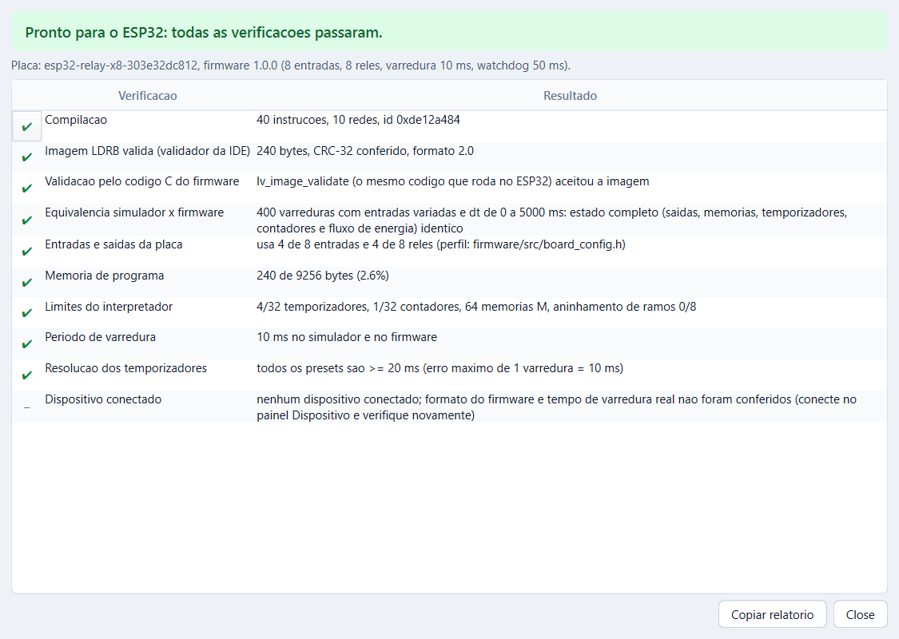

Antes de gravar, a IDE confere o programa contra o código C do firmware. Ela valida a imagem LDRB, executa 400 varreduras com entradas variadas no simulador e no firmware e compara o estado completo. Também confere E/S da placa, memória de programa, limites do interpretador, período de varredura e resolução dos temporizadores.

### 7.6 Outras funcionalidades

- **Gravar firmware na placa** pela própria IDE (esptool), sem instalar o PlatformIO.
- **Exportar e importar** a listagem LIL e o binário LDRB.
- **Linha de comando** (`python -m ladderide.cli`), inclusive o diagnóstico `factoryio` para testar a conexão Modbus.
- **Tema claro e escuro** (Ctrl+Shift+T) e layout dos painéis salvo entre sessões.
- **Instalador do Windows** em um único `.exe` (`LadderIDE-Setup-0.9.0.exe`), sem Python e sem administrador.

## Conclusão

A LadderIDE cobre o ciclo completo de um CLP: editar o diagrama, compilar, simular com processos animados ou com o Factory IO, verificar e transferir para o ESP32. Simulador e firmware executam o mesmo bytecode e são comparados varredura a varredura pelos 351 testes automatizados.

O firmware compila para o ESP32 e roda no PC como dispositivo virtual, mas ainda falta o teste na placa física.
